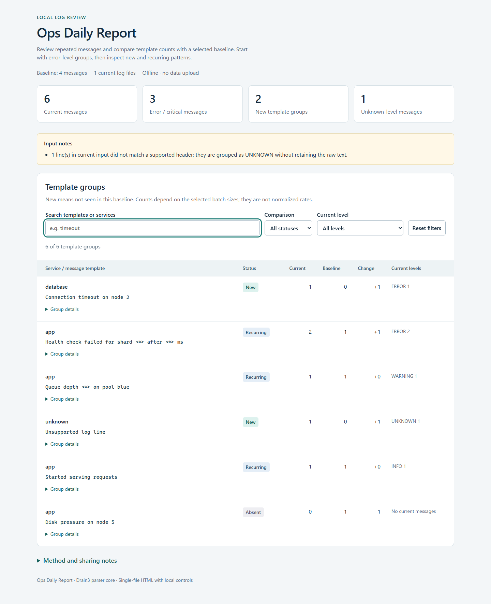

# Ops Daily Report

Turn a batch of service logs into a searchable, offline report of repeated
messages and changes from a selected baseline. Run it locally, then review the
HTML report in your browser or use the Markdown and JSON exports.

[](https://github.com/skyon0522-ai/ops-daily-report/actions/workflows/checks.yml)



In the synthetic example, health-check failures increase from one message to
two, a database timeout appears, and disk-pressure messages are absent from the
current batch. These are review cues; a new template does not establish an incident.

## Try the example

Requires Python 3.10 or later. Example logs are synthetic and included in the
repository; no accounts, containers or external services are needed.

```sh
python -m venv .venv
source .venv/bin/activate
python -m pip install -e '.[dev]'
ops-daily-report --log-dir examples/current --baseline-dir examples/baseline --output-dir reports/demo
```

On Windows PowerShell, activate with `.\.venv\Scripts\Activate.ps1` instead of
the `source` command. Open `reports/demo/report.html` in your browser. Search
templates or services, filter comparison status or current level, and inspect
group details. The report also works without JavaScript.

| Synthetic result | Current | Baseline |
| --- | ---: | ---: |
| Messages | 6 | 4 |
| Error-level messages | 3 | 2 |
| Warning-level messages | 1 | 1 |
| Unknown-level messages | 1 | 0 |

The unknown-level example contains the word `ERROR` in the message body; it is
not promoted to error severity. Levels come from supported headers.

## Read and run

- [Usage and comparison meanings](docs/usage.md)
- [Implementation and data flow](docs/architecture.md)
- [Copied source and licenses](docs/source.md)
- [Research basis and its limits](docs/research.md)
- [Development and verification](docs/development.md)
- [Committed demo outputs](examples/reports/)

For a terminal summary, run `ops-daily-report --log-dir sample_logs`.
Omit `--baseline-dir` to leave comparison fields uncomputed. Generated files
are not overwritten; use a fresh output directory for each run. Input logs are
not modified. Templates can retain sensitive text: review outputs before sharing.

## Built from a working parser

The engine executes a copied, pinned subset of
[Drain3](https://github.com/logpai/Drain3/tree/0fb6d6e1828838fa05c8f6fa5cda878e02ea79c7),
with its source-behavior tests and license notices. Added behavior includes
header-based levels, service separation, comparison of two batches, safe report
presentation and local search.

The method comes from He et al.,
[Drain: An Online Log Parsing Approach with Fixed Depth Tree, ICWS 2017](https://doi.org/10.1109/ICWS.2017.13).
That peer-reviewed paper supports the parsing method; this repository's tests
validate its defined behavior separately.

## Development

```sh
python -m pytest -q
python scripts/check_demo.py
```

The suite includes the copied Drain3 cases and tests for this app's parsing,
comparison, CLI and HTML escaping. The demo check compares the three committed
exports with a fresh run. The GitHub workflow tests Python 3.10 and 3.12; consult
its run page for actual remote results.

## Scope

This is a local batch-review app for supported text-log headers. It does not
select calendar days, stream live logs, assemble multiline stack traces,
diagnose incidents or send alerts. Unsupported lines remain counted as unknown.
Template grouping can merge or split events and depends on the selected inputs
and parser settings. No production accuracy or incident outcome is claimed.

The app is MIT-licensed. Copied components retain their applicable MIT and
Apache-2.0 notices; see [source and licenses](docs/source.md).
